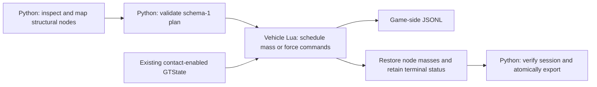

# Support garage experiments

Opt-in, stationary experiments for recording corner support response. Static
ballast changes selected structural node masses; baseline-release tests apply
held world-vertical forces and then release them. These are experimental tools,
not part of the normal driving controller. They record measurements; they do not
fit a vehicle model or claim exact real-world occupant/cargo placement.



## Reading map

| File | Responsibility |
|---|---|
| [garage_control.py](../src/bng_xal/bng_simulator/bng_simulator/core/garage_control.py) | Plan/node validation, ROS client, monitoring and host artifacts |
| [supportGarage.lua](../luamod/lua/vehicle/extensions/xlab/supportGarage.lua) | Live validation, physics schedule, restoration and game recording |
| [UTV profile](../src/bng_xal/bng_bringup/config/garage/utv_seats_rear.yaml) | Canonical source-verified seat/cargo groups and editable experiment settings |
| [request_handler.py](../src/bng_xal/bng_simulator/bng_simulator/core/request_handler.py) | Existing service-to-vehicle socket relay |

## Prepare and run

Build/install the xlab Lua mod and source the ROS workspace. The vehicle must be
stationary on flat ground, with four fresh positive contact loads and one selected
contact-enabled GTState instance. Normal LLC sensor defaults enable contact;
attach/calibration defaults disable it. No separate GT logger is required.
Keep autonomous driving and active assistance from changing the test conditions.

For the source-verified Easylift frame:

```bash
ros2 launch bng_bringup simulator.launch.py vehicle:=utv_canam_x3_r322_easylift
```

Keep the launch running; use another sourced terminal:

```bash
ros2 run bng_simulator sim_control garage-inspect \
  --vehicle EGO --output /tmp/garage-inventory.json

ros2 run bng_simulator sim_control garage-plan \
  --vehicle EGO --preset utv_seats_rear --output /tmp/garage-plan.yaml
```

Review the selected node names/positions, placement weights, and vehicle identity.
Set `config.cogHeightEstimate` in the generated plan to your estimate in metres
above the flat contact plane. It defaults to `null`: the draft cannot run until
you supply this value. The preset only supports the verified UTV frame named in
the profile; it is not a generic vehicle mapping.

```bash
ros2 run bng_simulator sim_control garage-run \
  --vehicle EGO --plan /tmp/garage-plan.yaml --output /tmp/garage-run-001

ros2 run bng_simulator sim_control garage-status --vehicle EGO
```

The host output directory must not exist. A generated plan has `schemaVersion: 1`,
`config`, the inspected `referenceNodes`, `selectedNodeReference`, and vehicle
identity. Unknown keys, unsupported versions, changed node geometry, duplicate
nodes, and malformed weights are rejected before start. Sensor names may change
between launches: the sole contact-enabled instance is resolved explicitly and
recorded; multiple instances require a matching `gtController` selection.

## Configuration and frames

The canonical profile contains `experiment` and `placements`. To use custom
geometry, copy/edit it and pass `garage-plan --placements /path/profile.yaml`
instead of `--preset`. A placement either names source-verified structural nodes,
or selects nearby nodes with an explicit filter:

```yaml
placements:
  rear_cargo:
    position_chassis_flu_m: [1.0, 0.0, 0.5] # example only; replace with measured coordinates
    node_pattern: 'frame|chassis'           # replace with the vehicle's structural groups
    radius_m: 0.2                          # search radius [m]
    count: 3                               # nearest unused matching nodes
experiment:
  mode: static_ballast
  cogHeightEstimate: null                  # supply a positive estimate [m]
  ballastKg: 10
  testPlacements:
    - name: rear_cargo
      weights: {rear_cargo: 1.0}
```

Coordinates use a fixed chassis frame: origin at reference node `ref`, forward
along `ref − back`, left from the reference-up/forward cross product, and up from
forward × left. They are not relative to a live ballast-dependent CoG. The height
estimate creates fixed body markers above the baseline contact plane; the existing
GT motion channels are copied without a second differentiation or lever transform.

| Config key | Default | Contract |
|---|---|---|
| `mode` | `static_ballast` | `static_ballast` or `baseline_release` |
| `cogHeightEstimate` | Required | Positive finite baseline height estimate [m] |
| `ballastKg` | 10 | Total added mass at the highest level, `(0,200]` kg |
| `forceN` | 200 | Total force at the highest level, `(0,2000]` N |
| `forceDirection` | `down` | `up`/`down`; upward force only in `baseline_release` |
| `levels` | 1 | 1–3 levels, amount = maximum × level / levels |
| `holdSeconds` | 8 | Hold duration per placement/level [s], at least 3 |
| `maxSpeed`, `maxRate` | 0.5, 0.5 | Abort thresholds [m/s], [rad/s] |
| `minLoadFraction` | 0.1 | Each corner must retain at least this fraction of its initial load |
| `maxLoadAge` | 0.05 | Maximum fresh-contact age [s], `(0,0.05]` |
| `massReadbackGrace` | 0.5 | Wait after a mass command before checking delayed readback, `[0.1,2]` s |
| `testPlacements` | Required | Explicit named location-weight mappings; no location-name-based schedule is inferred |
| `nodes` | Generated | Unique structural IDs; optional `{cid, weight}` entries |

Node weights sum to one per location; placement weights sum to one per test.
The tolerance is `1e-6` for float32 decoding noise. Lua additionally rejects wheel
nodes and invalid live masses before changing anything. Default schedules begin
with 8 s of reference, ramp for 3 s, hold, then remove ballast over 3 s and wait
7 s, or release force immediately and wait 7 s. All schedule times are vehicle
seconds. `--max-wall-seconds` separately bounds the host wait, default 1800 s.

## Outputs, stop and recovery

The run directory contains `inventory.json`, resolved `plan.yaml`, `started.json`,
`finished.json`, and `recording.jsonl` when transfer succeeds. The unique game-side
`/settings/support_garage_<id>.jsonl` path is saved before starting and is checked
through status, stop and every transferred chunk. A replaced session is neither
stopped nor exported by the old runner.

JSONL schema 4 records metadata, phase transitions, samples, exact commands,
optional mass-readback mismatches, and a final stop row when writing succeeds.
Samples retain load validity/age, fixed-marker heights, GT motion, and the commands
applied on the previous hook. New commands affect subsequent native integration;
commanded ballast and delayed native mass readback are separate fields.

Interrupting `garage-run` stops the matching session and attempts to export its
partial data, then reports the interruption. Stop can also be requested explicitly:

```bash
ros2 run bng_simulator sim_control garage-stop --vehicle EGO
ros2 run bng_simulator sim_control garage-recover \
  --vehicle EGO --output /tmp/garage-run-001 --stop-active
```

Standalone `garage-stop` targets the current session intentionally. Recovery checks
`started.json`; it refuses another session and writes `recording.recovered.jsonl`
without overwriting an existing file. An unfinished session requires the explicit
`--stop-active` option. Recovery can retrieve aborted/incomplete data; it does not
turn that experiment into a successful run.

Cleanup attempts every selected mass restoration even if writing fails. Terminal
status retains `restoreErrors` and `recordingErrors`; such sessions are not marked
complete. `finished.json` separates the experiment error from cleanup/transfer
errors. A failed transfer leaves no final recording filename. Reset relies on the
engine's native mass reset, rather than reapplying pre-reset fuel/node masses.

Service transfer is the default. For a shared filesystem, explicitly set
`BEAMNG_USER_PATH` to the simulator's active user folder as visible on the host.
No user-directory search occurs. A configured but missing/unreadable file fails
explicitly; unset the variable to use the service instead. If the connection is
lost, recover while Lua still retains this session, or retrieve its saved game-side
file directly. Keep the simulator launch alive until stop/export finishes.
