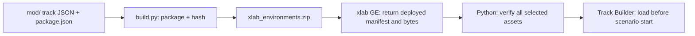

# xlab_environments

Track Builder assets packaged separately from the xlab sensor/controller mod.
Runs select additions to a vanilla base level; this package does not replace
level files or register a new Freeroam map.



## Reading map

| File | Responsibility |
|---|---|
| [package.json](package.json) | Asset names, paths, base levels and route defaults |
| [mod/trackEditor/xlab_environments](mod/trackEditor/xlab_environments) | Saved Track Builder definitions |
| [build.py](build.py) | Deterministic ZIP and generated SHA-256 manifest; atomic installation |
| [environment_assets.py](../src/bng_xal/bng_simulator/bng_simulator/core/environment_assets.py) | Verify the deployed batch before loading any selected track |
| [levels/](../src/bng_xal/bng_bringup/config/levels) | Asset selection and spawn positions |
| [Road geometry tools](../tools/road_geometry/README.md) | Evaluated geometry, route acquisition and collision validation |

## Build and install

From the repository root:

```bash
python3 environments/build.py
bash luamod/build.bash --linux
```

Each builder selects its ZIP destination in this order:

1. Explicit `--output` path.
2. `BEAMNG_MOD_DIR`, with `xlab_environments.zip` or `xlab.zip` as filename.
3. Package-local `dist/`, with a warning that the mod is not installed.

Both create missing destination directories and replace the previous ZIP only
when the complete build succeeds. Neither command starts or reloads the simulator.
For explicit local artifacts:

```bash
python3 environments/build.py --output /tmp/xlab_environments.zip
bash luamod/build.bash --linux --output=/tmp/xlab.zip
```

To install directly, set `BEAMNG_MOD_DIR` to `mods/` in the simulator's active
user folder. Select the target of the simulator: use `--win` for Windows BeamNG,
including when building from WSL; this requires MinGW. The environment ZIP itself
is identical on Linux and Windows. The Python builder also runs on Windows with
`py -3`; the Lua builder requires Bash and the target compiler.

The environment ZIP root contains `trackEditor/` and
`art/xlab_environments/manifest.json`. Copying `mod/` alone omits the generated
manifest and is not a complete installation. See [Lua build and runtime loading](../luamod/README.md#build-and-install)
for native-library packaging and caching.

## Select a track

Rebuild/source the ROS packages after configuration changes. The default
`single_vehicle.yaml` run selects Covet Turbo Rally on plain Tech Ground.
`tech_ground_oval.yaml` also selects Turbo Rally, with the banked donut added.
Select another environment or vehicle explicitly:

```bash
ros2 launch bng_bringup simulator.launch.py \
  level:=tech_ground_with_flat_circuit spawn:=on_track

ros2 launch bng_bringup simulator.launch.py \
  vehicle:=utv_canam_x3_r322_easylift \
  level:=tech_ground_with_banked_oval spawn:=on_track
```

| Asset | Level preset | Vehicle reference spawn [m] | ENU yaw |
|---|---|---|---|
| `donut_r15_b15` | `tech_ground_with_oval` | `[34, -30, 5.5]` | 0° |
| `flat_circuit` | `tech_ground_with_flat_circuit` | `[35, 30, 5.5]` | 0° |
| `rolling_hills_circuit` | `tech_ground_with_rolling_hills_circuit` | `[5, 0, 2.5]` | 0° |
| `banked_oval_b15` | `tech_ground_with_banked_oval` | `[35, 30, 5.5]` | 0° |

All presets use base level `tech_ground` and set `cling: false` for `on_track`.
`level:=` names a YAML preset under `config/levels/`; `spawn:=` must exist in that
preset. These shorthand overrides apply to single-vehicle runs. Multi-vehicle
runs specify their choices in `compose.vehicles`.

## Geometry and reproducibility

The current package version is recorded in `package.json`. The builder preserves
saved JSON bytes, adds their hashes to the generated manifest, and uses fixed
ZIP timestamps for repeatable artifacts. At launch, GE returns the actual deployed
bytes; Python verifies every selected hash and base level before loading any asset.
Resolved package/version/path/hash identities are retained in run metadata.

The donut is a closed 15 m radius circle with −15° bank. The banked oval is a
separate asset with two straights, two bends and a 20 m saved curve radius.
"Flat Circuit" describes constant design elevation and zero bank: the default
mesh cross-section is recessed, so its collision surface is not a perfect plane.
Use evaluated geometry and collision checks from the road tools rather than
interpreting saved design heights as measured surface heights.

The listed track spawn clearances remain provisional and need vehicle-specific
settling checks. The plain-ground parameter exports do not validate these elevated
track spawns. For new assets, add the saved JSON and manifest entry, define a level
preset with a measured spawn, rebuild the ZIP, and verify the deployed identity
before recording experiments. Bump the package version for released asset changes.
