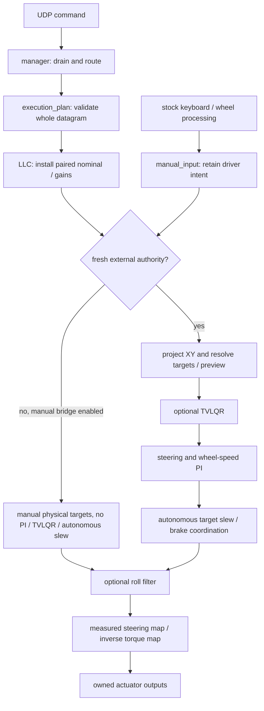

# XLab Lua mod

`xlab.zip` connects BeamNG vehicle physics to external control: UDP commands in,
measured state out, low-level actuation on the vehicle Lua thread. ROS startup
and scenario composition live in [bng_bringup](../src/bng_xal/bng_bringup/README.md).

## Reading map

Paths below are relative to `lua/vehicle/controller/xlab/`.

| File | Owns | Start reading at |
|---|---|---|
| [controller_manager.lua](lua/vehicle/controller/xlab/controller_manager.lua) | UDP sockets, routing, state refresh, plugin lifecycle | `update`, `routeIncomingMessage`, `runActuationTick` |
| [controller_llc.lua](lua/vehicle/controller/xlab/controller_llc.lua) | Source selection, targets, PI, slew, brake coordination, actuator output | `prepareControlStep` → `resolveSetpoints` → `applySetpoints` |
| [execution_plan.lua](lua/vehicle/controller/xlab/execution_plan.lua) | Complete XLP1/XLG1 datagram validation and decoding | `decode` |
| [llc_config.lua](lua/vehicle/controller/xlab/llc_config.lua) | Validate a candidate calibration before commit | `resolve` |
| [manual_input.lua](lua/vehicle/controller/xlab/manual_input.lua) | Capture processed driver intent; own/release individual output channels | `init`, `getTargets`, `apply`, `release` |
| [feedback_tvlqr.lua](lua/vehicle/controller/xlab/feedback_tvlqr.lua) | Paired reference/gain correction, expiry | `setPlan`, `transform` |
| [roll_filter.lua](lua/vehicle/controller/xlab/roll_filter.lua) | Native observer/QP, manual ownership and bounded recovery | `observe`, `step` |
| [vehicle_environment.lua](lua/vehicle/controller/xlab/vehicle_environment.lua) | XLE1 reception, native projection and physical parameters | `onPacket`, `prepare` |
| [steering_map.lua](lua/vehicle/controller/xlab/steering_map.lua) | Measured input ↔ roadwheel-angle interpolation | `new` |
| [gtState.lua](lua/vehicle/controller/xlab/gtState.lua) | Physics measurements, torque estimates, custom diagnostics | `update`, `getLatest` |

GE entry points under `lua/ge/extensions/` receive BeamNGpy requests and stage
native libraries. Vehicle extensions under `lua/vehicle/extensions/xlab/` create
the per-vehicle controllers. Neither runs the control law in the GE thread.

## Execution flow



The manager drains incoming messages, refreshes shared measured state once per
GT sample, emits due state/sensor streams, then runs actuation. Control uses elapsed
vehicle time; packet reception and preview do not define the actuation interval.

The LLC has one command authority. Valid replacement preserves PI/slew history;
release, timeout, bypass and reset clear the relevant command history. Manual
fallback is enabled with the input bridge for roll filtering. Bypass returns
control to stock driver processing. See the [execution contract](FEEDBACK_CONTRACT.md)
for exact expiry, handoff, units and failure behavior.

## Configuration ownership

The [vehicle catalog](../src/bng_xal/bng_bringup/config/vehicle_catalog.yaml)
selects the model/part configuration, drivetrain map and controller defaults.
The exported `vehicles/` calibration supplies the steering `(input, angle)` pairs;
the composer injects them into `calibration.steering_map`. The map supports
asymmetric measured locks. No nominal steering coefficient is substituted.
Run presets and explicit runtime tunes override the selected settings.

| Namespace under `LowLevelController` | Meaning |
|---|---|
| `calibration` | PI gains, target selection/preview, independent autonomous slew, brake coordination, plan IDs/age |
| `feedback`, `feedback_config` | Optional plugin and receiver settings; gains K arrive in XLG1 |
| `environment` | Packaged native model export, frame/epoch and projection settings |
| `roll_filter` | Mode, observer, bounds, QP metric and recovery settings |
| `manual_input` | Optional manual reference ramps; brake stays unchanged |
| `measured_rates` | State-time derivative filter; `filter_tau_s`, `max_gap_s` |

Example **partial tune**; submit through the existing vehicle I/O client:

```json
{"type":"tune","data":{"calibration":{"gains":{"kp":100},"trajectory_pick":"preview","trajectory_preview":{"time_s":{"steering":0.05,"torque":0.05,"wheel_speed":0.05}}}}}
```

Each LLC calibration validates fully before commit. Invalid settings log a rejection
and preserve its gains, plan and history. Separate tune namespaces commit separately;
a mixed tune is not a transaction across the feedback and roll-filter plugins.

## Build and install

Requirements: Bash, `zip`, a C compiler and Python 3. Windows builds from
WSL additionally need `x86_64-w64-mingw32-gcc`. Native libraries require BeamNG's
`-disable-sandbox` option. Select the actual game's mods folder explicitly:

```bash
cd /path/to/sim_ros_framework/luamod
export BEAMNG_MOD_DIR=/mnt/c/Users/<you>/AppData/Local/BeamNG/BeamNG.tech/current/mods
./build.bash --win
```

For native Linux, set its mods folder and omit `--win`. Every build packages all
runtime Lua/JSON sources, including files not yet tracked by Git. There is no
tracked-only build mode.

Both mod builders choose their destination in this order:

1. Explicit `--output` ZIP path (`--output=/path/xlab.zip` for this Bash builder).
2. `BEAMNG_MOD_DIR`, when set, with the package's ZIP filename.
3. Local `dist/` under the package directory, with a warning that it is not installed.

Missing destination directories are created. Both builders replace the destination
only after the full archive is written successfully; failed builds preserve the
previous mod. Local examples from the repository root:

```bash
bash luamod/build.bash --output=/tmp/xlab.zip
python3 environments/build.py --output /tmp/xlab_environments.zip
```

`--vehicle-export=NAME` restricts native vehicle exports; by default all staged
exports under `lib/vehicles/` are built. Torque-map C sources under `lib/policies/`
are compiled into `lib/<stem>.dll` or `.so`, alongside `<stem>.manifest.json`
containing the target, library filename and SHA-256 of the compiled bytes.

Native vehicle source hashes are checked during packaging. Restage changed generated
exports before rebuilding. GE stages torque maps and vehicle libraries into immutable,
content-addressed files in BeamNG `tmp/`. Matching cached bytes are reused; missing
sources, mismatched caches, failed copies and unavailable native paths abort startup.
GE supplies paths/headers to the vehicle controller; it never compiles at startup.
Rebuild the mod after changing C exports so its binaries and manifests agree.

Torque-map selection is fixed after successful LLC initialization. Tuning the same
name is allowed; selecting a different map (including adding one to a controller
started without a map) requires stopping/recreating the controller. Reset preserves
that restriction. Other rejected calibration settings leave the accepted configuration
and command history unchanged.

Verify ZIP contents, enable the mod, then reload it and recreate the vehicle
(or restart the game). Source edits and `colcon build` alone do not reload Lua.
Track assets use the separate [environment package](../environments/README.md).

## Transport and diagnostics

| Path | Transport | Content |
|---|---|---|
| Commands / tuning | `control_listen` UDP | XLP1 nominal, XLG1 nominal+K, XLE1 environment; JSON scalar commands/tune/bypass/reset |
| Live state | `control_state_send` UDP | Shared measured state at `controlStateRate` |
| Sensor broadcast | `sensor_send` UDP | Due state, IMU and GPS packs |
| Logging | GE TCP poll | Complete GTState, including registered custom diagnostics |

GTState clocks are vehicle seconds carried as Lua doubles. Measured steering rate
uses GT sample times; torque rate differentiates the map estimate, not measured
wheel torque. Duplicate samples do not advance derivatives; gaps/regression invalidate
them until a new pair arrives. Raw steering rate feeds the roll filter; the smoothed
rate remains available separately.

`target_*`, `llc_*`, `tvlqr_*` and `rf_*` custom fields expose target selection,
PI, slew, feedback and filter decisions in the existing GTState log. Interpret
filter values together with status; unavailable context passes nominal commands
and does not imply active rollover protection. `shadow` evaluates without correcting;
`off` skips evaluation. Service brake is supplied to the model; parking brake
is unsupported by the filter and reports unavailable.

See [execution / feedback / roll-filter contract](FEEDBACK_CONTRACT.md) for
status codes and field units, and [surface sampling](../docs/simulator_operations.md#surface-geometry-and-wheel-material-fields-in-gtstate)
for height, normals, material and friction validity. Runtime commands, scenario
startup and recording are in [simulator operations](../docs/simulator_operations.md).

Garage ballast/force experiments are opt-in and separate from driving. See the
[support garage guide](../docs/support_garage.md) for configuration, frames,
recording, cleanup and recovery; the Lua entry is `extensions/xlab/supportGarage.lua`.
