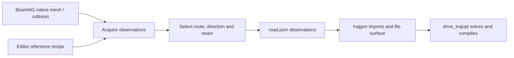

# Road geometry

Capture BeamNG road observations, inspect them, and publish an explicitly selected
route for trajgen. Measurements and authored reference intent remain separate.



Run commands from the repository root. Python needs NumPy; live commands also
need BeamNGpy and an accessible BeamNG instance. Offline reference rebuilding
requires Node.js. `--host` and `--port` precede the subcommand; defaults are
`127.0.0.1:25252`. Each command's `--help` lists its options.

## Managed asset

`--fresh` replaces the loaded scene with a paused, vehicle-free inspection scene.
Choose a new destination for each acquisition.

```bash
python3 tools/road_geometry/cli.py capture --asset flat_circuit --fresh --output /tmp/flat-road
python3 tools/road_geometry/cli.py serve /tmp/flat-road --http-port 8766
```

Open `http://localhost:8766/inspect.html`. A managed capture already has measured
routes; select a direction/seam/interval and export a named route in the viewer.
Saved selections live under the export's `selections/`; overwritten recipes keep
history. Directly opened HTML can download recipes instead of saving locally.

## Native level corridor

Survey observes the currently loaded scene unless `--fresh --level PRESET` is
explicitly supplied. Bounds are `[xmin ymin zmin xmax ymax zmax]`, in ENU metres.
Use bounds and a height band appropriate to the scene.

```bash
python3 tools/road_geometry/cli.py survey --bounds 0 0 -10 100 100 30 --spacing 1 --output /tmp/native-road
python3 tools/road_geometry/cli.py prepare /tmp/native-road --spacing 2 --height-band -10 30
python3 tools/road_geometry/cli.py serve /tmp/native-road
# In the editor, save a track recipe called my_track, then measure its corridor:
python3 tools/road_geometry/cli.py extract-path /tmp/native-road /tmp/native-road/selections/tracks/my_track.json --output /tmp/measured-road
```

`prepare` adds context/navigation to the survey workspace. Editor saves are fully
validated against its source snapshot. The reference is intent; `extract-path`
obtains actual collision heights/normals. Missing hits remain unavailable.

## Publish and validate

```bash
python3 tools/road_geometry/cli.py select-route /tmp/measured-road selection.json --output /tmp/chosen-road
python3 tools/road_geometry/cli.py validate /tmp/chosen-road
python3 tools/road_geometry/cli.py export-json /tmp/chosen-road --output /tmp/chosen-road/road.json
# Upgrade a legacy bundle into a separate destination, preserving the source:
python3 tools/road_geometry/cli.py normalize-routes OLD_EXPORT --output NEW_EXPORT
```

Use `export-json --route subtrack_1 --include-mesh` for a chosen managed route
when its verified mesh is also needed. Native corridors have no verified mesh.
`road.json` is `0.1-road-route-json`, consumed by
`drive_trajopt.trajgen.sites.import_beamng.import_beamng_route`. Fitting and
optimization-domain choices belong to trajgen. No closure, gap repair or measured
geometry smoothing is performed here.

## Reading map

| Responsibility | Files |
|---|---|
| Commands and live acquisition | `cli.py`, `acquisition.py` |
| Mesh/native observations and surface identity | `geometry.py`, `native_scene.py`, `surface_properties.py` |
| Recipe validation, directed references and replay | `track_recipe.py`, `guide_geometry.py`, `reference_path.py`, `rebuild_reference.py` |
| Route contract, row selection and JSON publication | `route_schema.py`, `route_selection.py`, `route_json.py` |
| Editors and visualization-only context | `local_server.py`, `viewer.py`, `route_context.py`, HTML/JS/CSS |

See [contracts, configuration and downstream ownership](../../docs/road_geometry.md)
for arrays, units, limits, failure rules and acquisition limitations. The original
[API investigation and plan](../../docs/road_geometry_export_plan.md) is historical.

## Offline checks

There are three test files: acquisition/geometry, saved-route workflows, and the
shared JavaScript planner/row selection. Run:

```bash
PYTHONDONTWRITEBYTECODE=1 python3 -m pytest -q -p no:cacheprovider tools/road_geometry
node tools/road_geometry/test_editor.js
```

These checks use synthetic observations and failure injection. They do not run
live collision acquisition, browser interaction or trajectory optimization.

A [recorded live Derby check](../../docs/road_geometry_validation_20261101.md)
exercised the browser, acquisition, reverse-route export and actual trajgen fitting.
It records results and the limits of that validation separately from these tests.
